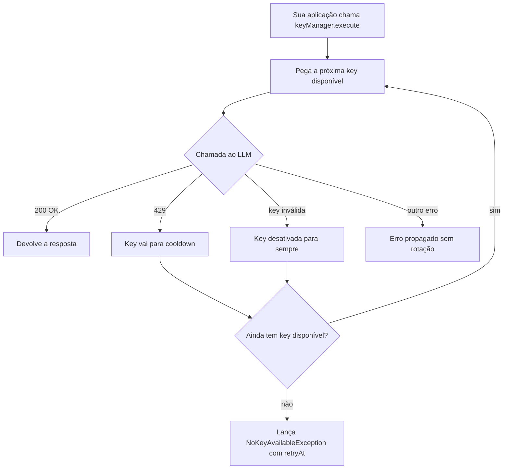

# 🔑 Key Manager

> Biblioteca Java que **rotaciona automaticamente API keys de LLMs** quando uma delas bate no limite de cota (HTTP 429) ou é invalidada. Você chama o modelo, ela cuida de qual key usar.


---

## 📌 Índice

- [O problema](#-o-problema)
- [Como funciona](#-como-funciona)
- [Estrutura do projeto](#-estrutura-do-projeto)
- [Começando (passo a passo)](#-começando-passo-a-passo)
- [Testando sem gastar cota](#-testando-sem-gastar-cota)
- [Usando com Spring Boot](#-usando-com-spring-boot)
- [Como cada erro é tratado](#-como-cada-erro-é-tratado)
- [Adicionando outro LLM](#-adicionando-outro-llm-openai-groq-etc)
- [Criando sua própria estratégia de rotação](#-criando-sua-própria-estratégia-de-rotação)
- [Rodando os testes](#-rodando-os-testes)
- [Limitações e avisos](#-limitações-e-avisos-leia)
- [Roadmap](#-roadmap)
- [Autor](#-autor)

---

## 🧨 O problema

APIs de LLM no plano gratuito têm limite de requisições por minuto e por dia. Quando você estoura, a API devolve **429 Too Many Requests** e sua aplicação quebra.

Se você tem mais de uma key (de projetos diferentes), dá pra continuar usando a próxima. Fazer isso na mão, em cada chamada, vira um monte de `try/catch` repetido e difícil de manter.

O **Key Manager** centraliza isso: você registra as keys uma vez, envolve a chamada ao LLM em `keyManager.execute(...)` e a lib decide qual key usar, quem está de castigo e quando cada uma volta.

---

## ⚙️ Como funciona



Em português claro:

1. Você pede pra executar uma chamada.
2. A lib escolhe uma key que **não está de castigo** (round-robin por padrão).
3. Se a chamada der **429**, a key vai pra **cooldown** (usa o `Retry-After` da API, ou um tempo padrão) e a lib **tenta de novo com a próxima key**, na mesma requisição. Quem chamou nem percebe.
4. Quando o cooldown acaba, a key **volta sozinha** ao rodízio. Sem requisição de teste, sem gastar cota.
5. Se **todas** as keys estiverem de castigo, a lib lança `NoKeyAvailableException` dizendo **quando** a primeira volta.

### Por que sem "requisição de teste"?

A ideia inicial era mandar uma requisição boba pra ver se a key voltou. Isso gasta cota justamente de quem está no limite. Usar um **cooldown com tempo** faz o mesmo trabalho sem custo.

---

## 🗂 Estrutura do projeto

```
keyManager/
├── pom.xml                      # parent (multi-módulo)
├── key-manager-core/            # a biblioteca em si, sem Spring e sem HTTP
│   └── src/main/java/com/github/jasonkauan/keymanager/
│       ├── ApiKey.java                 # uma key + estado (ACTIVE, COOLDOWN, DISABLED)
│       ├── KeyStatus.java
│       ├── KeyPool.java                # guarda as keys e entrega a próxima
│       ├── KeyManager.java             # o execute(...): coração da lib
│       ├── LlmProvider.java            # interface: o que muda de um LLM pra outro
│       ├── RotationStrategy.java       # interface: como escolher a próxima key
│       ├── RoundRobinStrategy.java     # implementação padrão (thread-safe)
│       └── NoKeyAvailableException.java
└── key-manager-gemini/          # módulo opcional: provider e client para o Gemini
```

**Decisão de design:** o `core` não depende de Spring, Jackson nem de nenhum cliente HTTP. Ele só recebe uma função que faz a chamada e um `LlmProvider` que sabe **interpretar o erro**. Por isso funciona em qualquer projeto Java, com qualquer cliente HTTP.

---

## 🚀 Começando (passo a passo)

### 1. Pré-requisitos

Abra o terminal e confira:

```bash
java -version    # precisa ser 17 ou maior
mvn -v           # Maven instalado
git --version
```

Se algum não for reconhecido, instale antes de continuar.

### 2. Baixe e instale a biblioteca na sua máquina

```bash
git clone https://github.com/JasonKauan/keyManager.git
cd keyManager
mvn clean install
```

O final tem que mostrar `BUILD SUCCESS`. Isso instala a lib no seu repositório Maven local (`~/.m2`), e qualquer projeto seu na mesma máquina já consegue usá-la.

### 3. Adicione a dependência no seu projeto

No `pom.xml` do **seu** projeto:

```xml
<dependency>
    <groupId>com.github.JasonKauan</groupId>
    <artifactId>key-manager-core</artifactId>
    <version>0.1.0-SNAPSHOT</version>
</dependency>
```

### 4. Pegue suas API keys

Para o Gemini, crie as keys no [Google AI Studio](https://aistudio.google.com/). Leia a seção [Limitações e avisos](#-limitações-e-avisos-leia) antes de criar várias.

### 5. Guarde as keys em variável de ambiente (nunca no código)

Separe por vírgula, **sem espaços** e **sem aspas** dentro do valor:

**Windows (PowerShell):**
```powershell
$env:GEMINI_API_KEYS="key1,key2,key3"
```

**Linux / macOS:**
```bash
export GEMINI_API_KEYS="key1,key2,key3"
```

> ⚠️ A variável só vale para a janela do terminal onde você definiu. Rode a aplicação **na mesma janela**. Para deixar permanente, use as variáveis de ambiente do sistema ou da sua IDE.
>
> 🔒 **Nunca faça commit das suas keys.** Adicione arquivos `.env` e `application-local.*` ao `.gitignore`.

### 6. Monte o gerenciador

```java
import com.github.jasonkauan.keymanager.*;
import java.time.Clock;
import java.util.ArrayList;
import java.util.List;

String[] valores = System.getenv("GEMINI_API_KEYS").split(",");

List<ApiKey> keys = new ArrayList<>();
for (int i = 0; i < valores.length; i++) {
    keys.add(new ApiKey("key-" + i, valores[i].trim())); // o id é só um apelido para logs
}

KeyPool pool = new KeyPool(keys, new RoundRobinStrategy(), Clock.systemUTC());
KeyManager keyManager = new KeyManager(pool, new SeuProvider()); // veja a seção abaixo
```

### 7. Faça suas chamadas através do `execute`

```java
String resposta = keyManager.execute(key -> meuClienteHttp.chamar(key.value(), prompt));
```

Pronto. Se a key da vez tomar 429, a lib troca e repete a chamada sozinha.

---

## 🧪 Testando sem gastar cota

Quer ver a rotação funcionando em 30 segundos, **sem nenhuma key real**? Crie uma classe `Demo.java` no seu projeto:

```java
import com.github.jasonkauan.keymanager.*;
import java.time.Clock;
import java.time.Duration;
import java.util.List;
import java.util.Optional;

public class Demo {
    public static void main(String[] args) {

        // Provider de mentira: diz que RuntimeException("429") é rate limit
        LlmProvider provider = new LlmProvider() {
            public String name() { return "demo"; }
            public Optional<Duration> asRateLimit(Throwable e) {
                return (e instanceof RuntimeException && "429".equals(e.getMessage()))
                        ? Optional.of(Duration.ofSeconds(30))
                        : Optional.empty();
            }
        };

        KeyPool pool = new KeyPool(
                List.of(new ApiKey("key-A", "valor-A"), new ApiKey("key-B", "valor-B")),
                new RoundRobinStrategy(),
                Clock.systemUTC());
        KeyManager manager = new KeyManager(pool, provider);

        for (int i = 1; i <= 3; i++) {
            String r = manager.execute(key -> {
                if (key.id().equals("key-A")) throw new RuntimeException("429"); // A "estourou" a cota
                return "Resposta usando " + key.id();
            });
            System.out.println(i + " -> " + r);
        }
    }
}
```

**Saída esperada:**
```
1 -> Resposta usando key-B
2 -> Resposta usando key-B
3 -> Resposta usando key-B
```

A `key-A` tomou o "429" na primeira chamada, foi pra cooldown de 30s e a `key-B` assumiu. As chamadas seguintes nem tentam a `key-A`.

---

## 🌱 Usando com Spring Boot

Funciona em qualquer versão do Spring, porque o `core` não depende dele. Exemplo completo com `RestClient` (Spring 6.1+ / Boot 3.2+).

### 1. Provider do Gemini

O `LlmProvider` é a única peça que **conhece o formato de erro do LLM**. Ele traduz exceções em decisões:

```java
import com.github.jasonkauan.keymanager.LlmProvider;
import org.springframework.web.client.RestClientResponseException;

import java.time.Duration;
import java.util.Optional;

public class GeminiLlmProvider implements LlmProvider {

    private static final Duration COOLDOWN_PADRAO = Duration.ofSeconds(65);

    @Override
    public String name() { return "gemini"; }

    @Override
    public Optional<Duration> asRateLimit(Throwable e) {
        if (e instanceof RestClientResponseException r && r.getStatusCode().value() == 429) {
            String retryAfter = r.getResponseHeaders() != null
                    ? r.getResponseHeaders().getFirst("Retry-After") : null;
            try {
                return Optional.of(retryAfter != null
                        ? Duration.ofSeconds(Long.parseLong(retryAfter.trim()))
                        : COOLDOWN_PADRAO);
            } catch (NumberFormatException ex) {
                return Optional.of(COOLDOWN_PADRAO);
            }
        }
        return Optional.empty();
    }

    @Override
    public boolean isInvalidKey(Throwable e) {
        return e instanceof RestClientResponseException r
                && (r.getStatusCode().value() == 403
                    || (r.getStatusCode().value() == 400
                        && r.getResponseBodyAsString().contains("API_KEY_INVALID")));
    }
}
```

### 2. Client que usa o `KeyManager`

```java
import com.github.jasonkauan.keymanager.*;
import org.springframework.beans.factory.annotation.Value;
import org.springframework.http.MediaType;
import org.springframework.stereotype.Component;
import org.springframework.web.client.RestClient;

import java.time.Clock;
import java.util.ArrayList;
import java.util.List;
import java.util.Map;

@Component
public class GeminiClient {

    private static final String URL =
            "https://generativelanguage.googleapis.com/v1beta/models/{modelo}:generateContent";

    private final RestClient http = RestClient.create();
    private final KeyManager keyManager;
    private final String modelo;

    public GeminiClient(@Value("${gemini.api-keys}") List<String> chaves,
                        @Value("${gemini.model}") String modelo) {
        this.modelo = modelo;
        List<ApiKey> keys = new ArrayList<>();
        for (int i = 0; i < chaves.size(); i++) {
            keys.add(new ApiKey("key-" + i, chaves.get(i).trim()));
        }
        this.keyManager = new KeyManager(
                new KeyPool(keys, new RoundRobinStrategy(), Clock.systemUTC()),
                new GeminiLlmProvider());
    }

    public String gerar(String prompt) {
        return keyManager.execute(key -> http.post()
                .uri(URL, modelo)
                .header("x-goog-api-key", key.value())
                .contentType(MediaType.APPLICATION_JSON)
                .body(Map.of("contents", List.of(
                        Map.of("parts", List.of(Map.of("text", prompt))))))
                .retrieve()
                .body(String.class));
    }
}
```

> O Spring converte `"key1,key2,key3"` em `List<String>` automaticamente.

### 3. `application.properties`

```properties
gemini.model=NOME-DO-MODELO
gemini.api-keys=${GEMINI_API_KEYS}
```

Troque `NOME-DO-MODELO` pelo nome atual do modelo no Google AI Studio (os nomes mudam com o tempo).

### 4. Use onde precisar

```java
@RestController
class ChatController {
    private final GeminiClient gemini;
    ChatController(GeminiClient gemini) { this.gemini = gemini; }

    @GetMapping("/ask")
    String ask(@RequestParam String q) { return gemini.gerar(q); }
}
```

### Dica: modelo reserva

A cota do Gemini é **por modelo**. Se você usa um modelo reserva, crie **um `KeyManager` por modelo** (um `Map<String, KeyManager>`), assim o cooldown de uma key no modelo principal não a bloqueia no reserva.

---

## 🚦 Como cada erro é tratado

| Situação | O que a lib faz |
|---|---|
| ✅ Chamada deu certo | Devolve o resultado. |
| 🟡 **429** (limite de cota) | Key vai pra cooldown (`Retry-After` ou tempo padrão) e a lib **tenta a próxima key** na mesma chamada. |
| 🔴 **Key inválida** (403, ou 400 `API_KEY_INVALID`) | Key é **desativada de vez** e a lib tenta a próxima. |
| 🟠 **503**, timeout, falha de conexão | Não é problema da key: o erro **é repassado** para o seu código tratar (retry, modelo reserva...). |
| ⚪ Qualquer outro erro (ex.: prompt inválido) | **Propaga sem rotacionar**, porque outra key daria o mesmo erro. |
| ⛔ Todas as keys em cooldown | Lança `NoKeyAvailableException`; use `e.retryAt()` para saber quando tentar de novo. |

O que conta como "rate limit" ou "key inválida" é definido por você no `LlmProvider`. É isso que deixa a lib agnóstica de modelo.

---

## 🔌 Adicionando outro LLM (OpenAI, Groq, etc.)

Basta implementar **3 métodos**:

```java
public class MeuOutroProvider implements LlmProvider {

    @Override
    public String name() { return "outro-llm"; }

    @Override
    public Optional<Duration> asRateLimit(Throwable e) {
        // Se o erro for "limite estourado", devolva quanto esperar. Senão, Optional.empty().
    }

    @Override
    public boolean isInvalidKey(Throwable e) {
        // true se o erro significa "essa key não presta mais" (opcional, o padrão é false)
    }
}
```

O resto (pool, rodízio, cooldown, `execute`) é reaproveitado sem mudar uma linha.

---

## 🎛 Criando sua própria estratégia de rotação

O padrão é round-robin. Para outra lógica (aleatória, a que foi usada há mais tempo, com pesos...), implemente:

```java
public interface RotationStrategy {
    Optional<ApiKey> pick(List<ApiKey> keys, Instant now);
}
```

E passe no `KeyPool`:

```java
new KeyPool(keys, new MinhaEstrategia(), Clock.systemUTC());
```

Use `key.isAvailable(now)` para ignorar keys em cooldown ou desativadas.

---

## ✅ Rodando os testes

```bash
mvn clean test
```

Os testes cobrem, usando um relógio falso (sem esperar nada de verdade):

- rotação quando uma key toma 429;
- key inválida desativada permanentemente;
- key que volta ao rodízio depois do cooldown;
- `NoKeyAvailableException` quando todas estão de castigo;
- erros que não são rate limit propagando sem rotação;
- alternância do round-robin e pulo de keys em cooldown.

---

## ⚠️ Limitações e avisos (leia)

- **Não existe "LLM grátis infinita".** A lib distribui a carga entre as keys que você tem; o limite total é a soma delas.
- **A cota normalmente é por projeto, não por key.** Várias keys do **mesmo** projeto do Google Cloud dividem a mesma cota, e a rotação não ajuda. Só faz diferença com keys de projetos diferentes.
- **Respeite os termos de uso do provedor.** Alguns proíbem criar várias contas/projetos para burlar limites do plano gratuito. Confira os termos antes de usar esta lib com esse objetivo. Usos legítimos: ambientes separados (dev/staging/prod), projetos independentes seus ou keys de pessoas do seu time.
- **O estado é em memória.** Se a aplicação reiniciar, os cooldowns são esquecidos. Com várias instâncias, cada uma tem o seu próprio estado (veja o roadmap).
- **O cooldown padrão é uma estimativa.** Se a API não manda `Retry-After`, ajuste o tempo no seu `LlmProvider`. Para limite **diário**, um cooldown maior evita requisições desperdiçadas.
- **Em produção com tráfego real**, considere um plano pago do provedor. Costuma ser mais estável e barato.

---

## 🗺 Roadmap

- [ ] Publicar no JitPack / Maven Central
- [ ] Spring Boot Starter (autoconfiguração via `application.yml`)
- [ ] `KeyStore` persistente (Redis / banco) para compartilhar estado entre instâncias
- [ ] Estratégias extras (aleatória, menos usada recentemente)
- [ ] Métricas (Micrometer): keys ativas, em cooldown, rotações por minuto
- [ ] Distinguir limite por minuto de limite diário no cooldown

---

## 👤 Autor

**Jason Kauan**
GitHub: [@JasonKauan](https://github.com/JasonKauan)

Projeto desenvolvido como estudo de design de bibliotecas Java (interfaces, composição, concorrência e testes com relógio injetável) e para uso em projetos reais.

---

## 📄 Licença

MIT.
